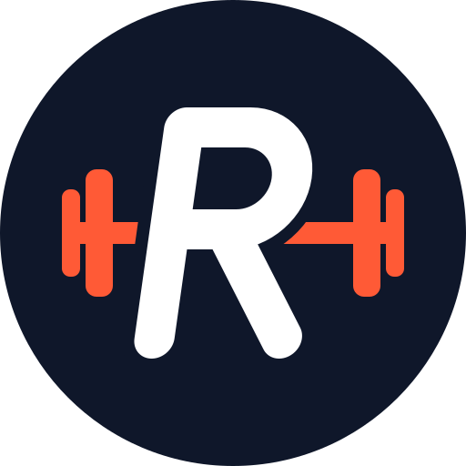

  <!-- TODO: change the path to where the logo lives in your repo -->
  

<h1 align="center">ACTIVE with Raph</h1>

  Lift. Run. Ride. Repeat. 
  Training guides, nutrition tips and handy calculators for strength, running and cycling.

  <a href="https://activewithraph.github.io/"><strong>Visit the website</strong></a>
  &nbsp;·&nbsp;
  <a href="https://www.instagram.com/activewithraph/">Instagram</a>

## Licence and credits

The source code is licensed under the [GNU General Public License v3.0](LICENSE). You are free to use, study, change
and share it, as long as you share your changes under the same licence.

The photos, the logo and the written content on the site are **not** part of that licence: they are © Raphaël Godart, all rights
reserved. Please don't reuse them without asking.